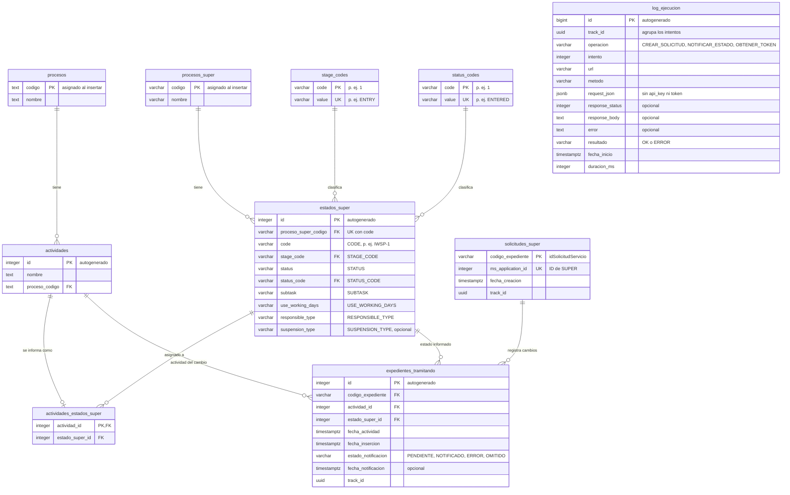

# ms-integracion-super

Servicio construido con **Next.js 16 (App Router)**, **React 19** y **TypeScript**. Expone endpoints REST documentados con OpenAPI y páginas de presentación para el usuario.

## Requisitos

- Node.js 22.12 o superior (lo exige Vitest 5)
- [pnpm](https://pnpm.io) (la versión está fijada en `packageManager` de `package.json`)

## Comandos

```bash
pnpm install              # instala dependencias
pnpm dev                  # aplica las migraciones pendientes y levanta el servidor en http://localhost:3000
pnpm build                # build de producción (incluye verificación de tipos)
pnpm start                # sirve el build de producción
pnpm exec tsc --noEmit    # solo verificación de tipos
pnpm test                 # tests unitarios con Vitest en modo watch
pnpm test --run           # tests unitarios una vez
pnpm test:integration     # tests de integración contra la API real de Mi Súper
```

### Tests

Los tests (`*.test.ts`) están en la carpeta `tests/`, separados en dos grupos que replican la estructura de `src/`:

- **`tests/unit/`**: no usan red ni el `.env`. Los servicios reciben dependencias falsas y las variables se definen con `vi.stubEnv`.
- **`tests/integration/`**: llaman a los servicios reales con las variables del `.env`, que apunta al ambiente de QA de Mi Súper.

El test que crea una solicitud en Mi Súper se omite por defecto, para no llenar QA de registros en cada ejecución. Para ejecutarlo:

1. Completa `tests/integration/fixtures/crear-solicitud-request.fixture.ts` con datos válidos.
2. Ejecuta `MISUPER_INTEGRATION_CREAR_SOLICITUD=true pnpm test:integration`.

## Base de datos

PostgreSQL con [Drizzle ORM](https://orm.drizzle.team). Todas las tablas viven en el esquema `super`, incluido el historial de migraciones (`super.__drizzle_migrations`). Las tablas se definen en `src/core/repository/entity/` y las consultas en `src/core/repository/dao/`.

```bash
pnpm db:generate --name <cambio>   # genera la migración SQL a partir de las entidades
pnpm db:migrate                    # aplica las migraciones pendientes en DATABASE_URL
pnpm db:studio                     # explorador web de la base de datos
```

`pnpm dev` ejecuta `db:migrate` antes de levantar el servidor. `pnpm start` no lo hace: en cada despliegue hay que ejecutar `pnpm db:migrate` antes de iniciar la aplicación.

La carpeta `drizzle/` es el historial de migraciones y se versiona en git. Cada cambio de esquema se hace modificando las entidades y ejecutando `db:generate`.

### Modelo entidad-relación



### Tablas

Las tablas se agrupan en cuatro áreas: proceso interno, configuración de SUPER, expedientes y trazabilidad.

**Proceso interno**

| Tabla | Columnas | Notas |
|---|---|---|
| `procesos` | `codigo` (PK), `nombre` | El código se asigna al insertar |
| `actividades` | `id` (PK autogenerada), `nombre`, `proceso_codigo` (FK) | Cada actividad pertenece a un único proceso |

**Configuración de SUPER**

| Tabla | Columnas | Notas |
|---|---|---|
| `procesos_super` | `codigo` (PK), `nombre` | El código se asigna al insertar |
| `estados_super` | `id` (PK autogenerada), `proceso_super_codigo` (FK), `code`, `stage_code` (FK), `status`, `status_code` (FK), `subtask`, `use_working_days`, `responsible_type`, `suspension_type` | Estados que se informan a SUPER. Las columnas en inglés son los campos del manual de SUPER y se guardan sin validar formato |
| `stage_codes` | `code` (PK), `value` (único) | Catálogo de `STAGE_CODE`, por ejemplo `1` → `ENTRY` |
| `status_codes` | `code` (PK), `value` (único) | Catálogo de `STATUS_CODE`, por ejemplo `1` → `ENTERED` |
| `actividades_estados_super` | `actividad_id` (PK, FK), `estado_super_id` (FK) | Qué estado SUPER se informa en cada actividad. Una actividad sin fila no se informa |

**Expedientes**

| Tabla | Columnas | Notas |
|---|---|---|
| `solicitudes_super` | `codigo_expediente` (PK), `ms_application_id` (único), `fecha_creacion`, `track_id` | Solicitud creada en SUPER para cada expediente (1:1). La llena `POST /api/super/solicitudes` cuando SUPER responde OK |
| `expedientes_tramitando` | `id` (PK autogenerada), `codigo_expediente` (FK), `actividad_id` (FK), `estado_super_id` (FK), `fecha_actividad`, `fecha_insercion`, `estado_notificacion`, `fecha_notificacion`, `track_id` | Historial de cambios de actividad de cada expediente. Solo se inserta cuando la actividad cambió |

**Trazabilidad**

| Tabla | Columnas | Notas |
|---|---|---|
| `log_ejecucion` | `id` (PK autogenerada), `track_id`, `operacion`, `intento`, `url`, `metodo`, `request_json`, `response_status`, `response_body`, `error`, `resultado`, `fecha_inicio`, `duracion_ms` | Una fila por cada llamada HTTP a SUPER |

### Reglas

**Configuración de SUPER**

- `estados_super.code` es único dentro de cada proceso SUPER: el mismo código puede repetirse en otro proceso.
- `stage_code` y `status_code` solo aceptan códigos registrados en `stage_codes` y `status_codes`, y guardan el código interno (`"1"`), no el valor (`ENTRY`).
- Las FK de `estados_super` usan `ON UPDATE CASCADE` (si cambia un código, los estados lo siguen) y `ON DELETE RESTRICT` (no se puede borrar un proceso ni un código en uso).
- Una actividad informa como máximo un estado SUPER.

**Expedientes**

- Un expediente tiene una sola solicitud en SUPER, y un `ms_application_id` pertenece a un solo expediente.
- `expedientes_tramitando` no acepta dos veces el mismo cambio (`codigo_expediente`, `actividad_id`, `fecha_actividad`) ni expedientes sin solicitud en `solicitudes_super`.
- `estado_notificacion` vale `PENDIENTE` (por defecto), `NOTIFICADO`, `ERROR` u `OMITIDO`.

**Trazabilidad**

- `track_id` une las tablas de negocio con `log_ejecucion` **sin FK**, para que la trazabilidad no condicione al negocio. Los reintentos de una misma operación comparten `track_id`.
- `log_ejecucion` nunca guarda el `api_key` ni el token de SUPER: ambos se reemplazan por `***`.

### Datos iniciales

- La migración `0002` carga los códigos del manual, numerados en su orden:
  - 4 en `stage_codes`, de `1` → `ENTRY` a `4` → `FINISHED`;
  - 14 en `status_codes`, de `1` → `ENTERED` a `14` → `CLOSED`.

  Los que SUPER agregue después los ingresa el usuario.
- El resto de las tablas no tiene carga inicial. La configuración de `procesos_super`, `estados_super` y `actividades_estados_super` se cargará cuando esté definida la lógica de negocio final.

## Docker

La carpeta `cicd/` contiene el `Dockerfile` de producción. Usa la salida `standalone` de Next.js (`output: "standalone"` en `next.config.ts`), así que la imagen solo lleva `server.js` y las dependencias que realmente se usan. Se construye desde la raíz del repositorio:

```bash
docker build -f cicd/Dockerfile -t ms-integracion-super .
docker run -p 3000:3000 --env-file .env ms-integracion-super
```

- Con `DB_MIGRAR_AL_INICIAR=true` (el valor por defecto), al iniciar el contenedor crea el esquema `super` y aplica las migraciones pendientes (`cicd/migrate.mjs`, con el migrador de `drizzle-orm`) y después levanta el servidor. Si las migraciones fallan, el contenedor no arranca. Un *advisory lock* de PostgreSQL evita que varias réplicas migren a la vez: una migra y las demás esperan.
- Las variables de entorno se entregan al ejecutar el contenedor. La imagen no incluye el `.env` (lo excluye `cicd/Dockerfile.dockerignore`).
- Con `DB_MIGRAR_AL_INICIAR=false` el contenedor no toca la base de datos, por ejemplo cuando las migraciones se ejecutan en un paso aparte del pipeline.
- Dentro del contenedor, `localhost` es el propio contenedor. Para usar el PostgreSQL de tu máquina, cambia el host de `DATABASE_URL` por `host.docker.internal`.

### Docker Compose

`cicd/docker-compose.yml` levanta la aplicación junto a un PostgreSQL 17 propio, con sus datos en un volumen:

```bash
docker compose -f cicd/docker-compose.yml --env-file .env up --build -d   # levanta todo
docker compose -f cicd/docker-compose.yml --env-file .env logs -f app     # logs de la aplicación
docker compose -f cicd/docker-compose.yml --env-file .env down            # detiene (agrega -v para borrar los datos)
```

- La aplicación espera a que PostgreSQL esté listo y, con `DB_MIGRAR_AL_INICIAR=true`, crea el esquema y las tablas antes de aceptar peticiones.
- El `DATABASE_URL` del `.env` no se usa: el compose lo arma para apuntar al servicio `db`.
- Las variables `MISUPER_*` son obligatorias; si falta alguna, el compose no arranca y dice cuál.
- Variables opcionales y sus valores por defecto: `DB_MIGRAR_AL_INICIAR=true`, `APP_PORT=3000`, `POSTGRES_USER=postgres`, `POSTGRES_PASSWORD=postgres`, `POSTGRES_DB=ms_integracion_super` y `POSTGRES_PORT=5435` (el puerto de PostgreSQL en tu máquina).

## Variables de entorno

Copia `.env.example` a `.env` y completa los valores. El código accede a ellas solo a través de `EnvConfig` (`src/config/env.config.ts`). Si falta una variable, se lanza un error con su nombre al usarla.

## Arquitectura

El proyecto usa una **arquitectura en capas simplificada**. Se eligió a propósito en lugar de Clean Architecture completa (casos de uso, puertos, contenedor de dependencias), porque el proyecto no será grande.

### Flujo de una petición

```
Cliente HTTP
    │
    ▼
app/api/<endpoint>/route.ts      Capa de exposición: valida la entrada (Zod) y arma la respuesta HTTP
    │
    ▼
service/<feature>/*.service.ts   Capa de servicio: orquesta la lógica y llama a los repositorios
    │
    ▼
core/repository/dao/*.dao.ts     Capa de datos: consultas a PostgreSQL con Drizzle

core/domain/<feature>/           Dominio: entidades, reglas de negocio y errores; lo pueden usar todas las capas
```

Las dependencias van en un solo sentido: `api → service → repository`. Una capa nunca importa a la capa que está por encima.

### Estructura de carpetas

```
src/
├── app/
│   ├── (presentacion)/          Capa de presentación: páginas para el usuario
│   │   └── page.tsx             → se sirve en /
│   ├── api/                     Capa de exposición: endpoints REST
│   │   ├── super/solicitudes/
│   │   │   ├── route.ts         Handler HTTP
│   │   │   └── solicitudes.schema.ts  Contrato: esquemas Zod y registro OpenAPI
│   │   ├── openapi/             Especificación OpenAPI generada (/api/openapi)
│   │   └── docs/                Documentación interactiva (/api/docs)
│   ├── layout.tsx               Layout raíz (Next.js lo exige aquí)
│   ├── globals.css
│   └── favicon.ico              (Next.js lo exige aquí)
├── config/
│   ├── env.config.ts            Acceso a las variables de entorno (EnvConfig)
│   └── db.config.ts             Conexión a PostgreSQL (Drizzle)
├── core/
│   ├── domain/                  Clases de dominio y reglas de negocio
│   └── repository/              Acceso a datos
│       ├── entity/              Tablas (una entidad por archivo) y relaciones
│       └── dao/                 Consultas sobre cada entidad
└── service/                     Servicios de orquestación
drizzle/                         Historial de migraciones SQL (generado con pnpm db:generate)
cicd/                            Dockerfile, docker-compose.yml y script de migraciones del contenedor
```

### Responsabilidades por capa

| Capa | Ubicación | Responsabilidad | No debe |
|---|---|---|---|
| Presentación | `src/app/(presentacion)/` | Páginas que ve el usuario | — |
| Exposición | `src/app/api/` | Validar la petición con Zod, llamar al servicio, armar la respuesta y convertir errores en códigos HTTP | Contener lógica de negocio |
| Servicio | `src/service/` | Orquestar: llamar a los repositorios y aplicar las reglas del dominio | Conocer `Request`/`Response` ni nada de HTTP |
| Repositorio | `src/core/repository/` | Obtener y guardar datos | Contener lógica de negocio |
| Dominio | `src/core/domain/` | Entidades, reglas de negocio y errores de dominio | Depender de otras capas o de Next.js |

### Sobre `(presentacion)`

En Next.js cada carpeta dentro de `app/` forma parte de la URL. Los paréntesis convierten la carpeta en un **route group**: sirve para organizar, pero no aparece en la URL. Así, `(presentacion)/page.tsx` se sirve en `/` y `(presentacion)/productos/page.tsx` en `/productos`. Si se quitan los paréntesis, todas las páginas pasan a estar bajo `/presentacion`.

## Endpoints

| Método | Ruta | Descripción |
|---|---|---|
| `POST` | `/api/super/solicitudes` | Recibe una solicitud y la crea en Mi Súper de forma asíncrona |
| `GET` | `/api/openapi` | Especificación OpenAPI 3.1 en JSON |
| `GET` | `/api/docs` | Documentación interactiva de la API (Scalar) |

### `POST /api/super/solicitudes`

Recibe una solicitud y la crea en Mi Súper de forma **asíncrona**. Responde `202` apenas la petición pasa las validaciones. La llamada a Mi Súper se ejecuta después de responder, con `after()` de Next.js. El contrato está en camelCase; el servicio lo traduce al formato snake_case que espera Mi Súper.

Después de responder, el servicio:

1. pide el token y crea la solicitud en Mi Súper, registrando cada llamada en `log_ejecucion` con el `trackId` de la respuesta (sin el `api_key` ni el token);
2. si Mi Súper responde OK, guarda `idSolicitudServicio` → `ms_application_id` en `solicitudes_super`.

Si Mi Súper rechaza la solicitud o no está disponible, quien llamó al endpoint no se entera: el resultado se consulta en `log_ejecucion` por `trackId`. Todavía no hay reintentos, y si el contenedor se detiene justo después de responder, esa solicitud no se envía.

El `service_id` de Mi Súper no se envía en la petición: el servicio lo toma de la variable de entorno `MISUPER_CHILE_ATIENDE_ID`.

**Cuerpo** (`application/json`)

| Campo | Tipo | Requerido | Descripción |
|---|---|---|---|
| `tramiteId` | string | Sí | Trámite en Mi Súper (`procedure_id`) |
| `entradaId` | entero | No | Entrada previa en Mi Súper (`ms_entry_id`). Si se omite se envía `""` |
| `idSolicitudServicio` | string (máx. 50) | Sí | Código del expediente en nuestro sistema (`codigo_expediente`). Un expediente admite una sola solicitud |
| `tipoBeneficiario` | string | Sí | Por ejemplo `company` |
| `creador` | `{ tipo, datos: Persona }` | Sí | Quien crea la solicitud |
| `solicitante` | Persona | No | |
| `rutSolicitante` | string | Sí | RUT de quien solicita (`petitioner_rut`) |
| `rutEmpresa` | string | Sí | |
| `cup` | string | No | Si se omite se envía `""` |
| `region`, `comuna` | entero | No | Códigos de región y comuna |
| `direccion` | string | No | |

`Persona` = `{ rut, nombre, apellido, email }`.

```bash
curl -X POST http://localhost:3000/api/super/solicitudes \
  -H 'Content-Type: application/json' \
  -d '{"tramiteId":"59296","idSolicitudServicio":"prueba","tipoBeneficiario":"company",
       "creador":{"tipo":"petitioner","datos":{"rut":"12546655-1","nombre":"Claudio","apellido":"Perez","email":"claudio@test.cl"}},
       "rutSolicitante":"12546655-1","rutEmpresa":"35793623-3","region":15,"comuna":15101,"direccion":"agustinas 1212"}'
```

**Respuestas**

`202 Accepted`

```json
{ "trackId": "4926fd1b-4b1d-4f46-a8e2-7e44bb8956d9", "mensaje": "Solicitud recibida; se enviará a Mi Súper" }
```

| Estado | Cuándo |
|---|---|
| `400` | El cuerpo no es JSON o no cumple el contrato. El mensaje indica el campo (`tramiteId: ...`) |
| `409` | El expediente (`idSolicitudServicio`) ya tiene una solicitud en `solicitudes_super` |

Para ver qué pasó con una solicitud:

```sql
SELECT operacion, response_status, resultado, response_body
FROM super.log_ejecucion WHERE track_id = '<trackId>' ORDER BY id;
```

## Documentación de la API (OpenAPI)

La especificación se genera a partir de los mismos esquemas [Zod](https://zod.dev) que validan las peticiones, con [`@asteasolutions/zod-to-openapi`](https://github.com/asteasolutions/zod-to-openapi). Por eso la documentación no puede quedar desalineada con el código. La interfaz se muestra con [Scalar](https://scalar.com).

- Interfaz interactiva: <http://localhost:3000/api/docs>
- Especificación en JSON: <http://localhost:3000/api/openapi>, que se puede importar en Postman, Insomnia, etc.

La página `/api/docs` carga Scalar desde el CDN de jsDelivr, así que necesita conexión a internet en el navegador.

### Agregar un endpoint nuevo

1. **Dominio:** crea las entidades y reglas en `src/core/domain/<feature>/`.
2. **Repositorio:** crea la entidad en `src/core/repository/entity/` y sus consultas en `src/core/repository/dao/`.
3. **Servicio:** crea la orquestación en `src/service/<feature>/<feature>.service.ts`. El servicio recibe y devuelve tipos del dominio, nunca `Request` ni `Response`.
4. **Contrato:** crea `src/app/api/<ruta>/<ruta>.schema.ts` con los esquemas Zod de entrada y salida, y una función `register<Ruta>Paths(registry)`. Usa `.meta({ id, description, example })` para la documentación.
5. **Handler:** crea `src/app/api/<ruta>/route.ts`. Valida con el esquema (`safeParse`), llama al servicio y devuelve la respuesta tipada.
6. **Registro:** llama a `register<Ruta>Paths(registry)` en `src/app/api/openapi/openapi.document.ts`.
7. **README:** agrega el endpoint a la sección [Endpoints](#endpoints).

`src/app/api/super/solicitudes/` es el ejemplo de referencia.
