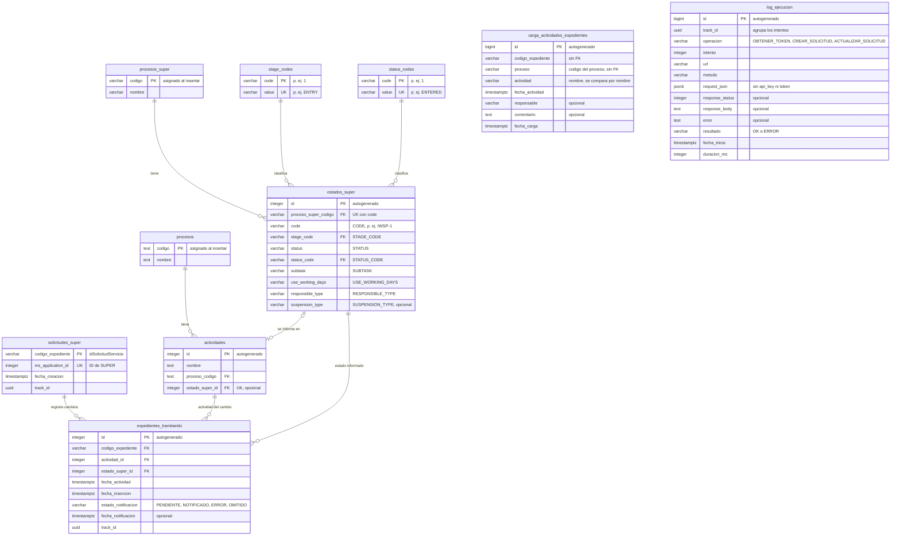

# ms-integracion-super

Servicio construido con **Next.js 16 (App Router)**, **React 19** y **TypeScript**. Expone endpoints REST documentados con OpenAPI y páginas de presentación para el usuario.

## Requisitos

- Node.js 22.12 o superior (lo exige Vitest 5)
- [pnpm](https://pnpm.io) (la versión está fijada en `packageManager` de `package.json`)

## Comandos

```bash
pnpm install              # instala dependencias
pnpm dev                  # aplica las migraciones pendientes y levanta el servidor en http://localhost:3000
pnpm build                # build de producción (incluye verificación de tipos)
pnpm start                # sirve el build de producción
pnpm exec tsc --noEmit    # solo verificación de tipos
pnpm test                 # tests unitarios con Vitest en modo watch
pnpm test --run           # tests unitarios una vez
pnpm test:integration     # tests de integración contra la API real de Mi Súper
```

### Tests

Los tests (`*.test.ts`) están en la carpeta `tests/`, separados en dos grupos que replican la estructura de `src/`:

- **`tests/unit/`**: no usan red ni el `.env`. Los servicios reciben dependencias falsas y las variables se definen con `vi.stubEnv`.
- **`tests/integration/`**: llaman a los servicios reales con las variables del `.env`, que apunta al ambiente de QA de Mi Súper.

El test que crea una solicitud en Mi Súper se omite por defecto, para no llenar QA de registros en cada ejecución. Para ejecutarlo:

1. Completa `tests/integration/fixtures/crear-solicitud-request.fixture.ts` con datos válidos.
2. Ejecuta `MISUPER_INTEGRATION_CREAR_SOLICITUD=true pnpm test:integration`.

## Base de datos

PostgreSQL con [Drizzle ORM](https://orm.drizzle.team). Todas las tablas viven en el esquema `super`, incluido el historial de migraciones (`super.__drizzle_migrations`). Las tablas se definen en `src/core/repository/entity/` y las consultas en `src/core/repository/dao/`.

```bash
pnpm db:generate --name <cambio>   # genera la migración SQL a partir de las entidades
pnpm db:migrate                    # aplica las migraciones pendientes en DATABASE_URL
pnpm db:studio                     # explorador web de la base de datos
```

`pnpm dev` ejecuta `db:migrate` antes de levantar el servidor. `pnpm start` no lo hace: en cada despliegue hay que ejecutar `pnpm db:migrate` antes de iniciar la aplicación.

La carpeta `drizzle/` es el historial de migraciones y se versiona en git. Cada cambio de esquema se hace modificando las entidades y ejecutando `db:generate`.

### Modelo entidad-relación

`carga_actividades_expedientes` aparece sin relaciones porque no tiene FK: es la tabla de entrada de la carga diaria.



### Tablas

Las tablas se agrupan en cinco áreas: proceso interno, configuración de SUPER, carga diaria, expedientes y trazabilidad.

**Proceso interno**

| Tabla | Columnas | Notas |
|---|---|---|
| `procesos` | `codigo` (PK), `nombre` | El código se asigna al insertar |
| `actividades` | `id` (PK autogenerada), `nombre`, `proceso_codigo` (FK), `estado_super_id` (FK, único, opcional) | Cada actividad pertenece a un único proceso. `estado_super_id` es el estado SUPER que se informa cuando un expediente pasa por ella; si es null, la actividad no se informa |

**Configuración de SUPER**

| Tabla | Columnas | Notas |
|---|---|---|
| `procesos_super` | `codigo` (PK), `nombre` | El código se asigna al insertar |
| `estados_super` | `id` (PK autogenerada), `proceso_super_codigo` (FK), `code`, `stage_code` (FK), `status`, `status_code` (FK), `subtask`, `use_working_days`, `responsible_type`, `suspension_type` | Estados que se informan a SUPER. Las columnas en inglés son los campos del manual de SUPER y se guardan sin validar formato |
| `stage_codes` | `code` (PK), `value` (único) | Catálogo de `STAGE_CODE`, por ejemplo `1` → `ENTRY` |
| `status_codes` | `code` (PK), `value` (único) | Catálogo de `STATUS_CODE`, por ejemplo `1` → `ENTERED` |

**Carga diaria**

| Tabla | Columnas | Notas |
|---|---|---|
| `carga_actividades_expedientes` | `id` (PK autogenerada), `codigo_expediente`, `proceso`, `actividad`, `fecha_actividad`, `responsable`, `comentario`, `fecha_carga` | Movimientos de actividad que un procedimiento externo carga cada día. Es solo de entrada y no tiene FK, para que una carga con datos desconocidos no falle. `proceso` es el código del proceso y `actividad` el nombre de la actividad: la actividad se identifica por ambos, no por id. Único por `codigo_expediente`, `actividad`, `fecha_actividad` |

**Expedientes**

| Tabla | Columnas | Notas |
|---|---|---|
| `solicitudes_super` | `codigo_expediente` (PK), `ms_application_id` (único), `fecha_creacion`, `track_id` | Solicitud creada en SUPER para cada expediente (1:1). La llena `POST /api/super/solicitudes` cuando SUPER responde OK |
| `expedientes_tramitando` | `id` (PK autogenerada), `codigo_expediente` (FK), `actividad_id` (FK), `estado_super_id` (FK), `fecha_actividad`, `fecha_insercion`, `estado_notificacion`, `fecha_notificacion`, `track_id` | Historial de cambios de actividad de cada expediente. Solo se inserta cuando la actividad cambió |

**Trazabilidad**

| Tabla | Columnas | Notas |
|---|---|---|
| `log_ejecucion` | `id` (PK autogenerada), `track_id`, `operacion`, `intento`, `url`, `metodo`, `request_json`, `response_status`, `response_body`, `error`, `resultado`, `fecha_inicio`, `duracion_ms` | Una fila por cada llamada HTTP a SUPER |

### Reglas

**Configuración de SUPER**

- `estados_super.code` es único dentro de cada proceso SUPER: el mismo código puede repetirse en otro proceso.
- `stage_code` y `status_code` solo aceptan códigos registrados en `stage_codes` y `status_codes`, y guardan el código interno (`"1"`), no el valor (`ENTRY`).
- Las FK de `estados_super` usan `ON UPDATE CASCADE` (si cambia un código, los estados lo siguen) y `ON DELETE RESTRICT` (no se puede borrar un proceso ni un código en uso).
- Una actividad y un estado SUPER se relacionan 1:1: una actividad tiene como máximo un estado SUPER (`actividades.estado_super_id`) y un estado SUPER pertenece a una sola actividad (restricción única). La FK usa `ON DELETE RESTRICT`: no se puede borrar un estado asignado a una actividad.

**Carga diaria**

- El procedimiento externo carga solo el último movimiento de cada expediente. Si un expediente se movió dos veces en el día, solo se informa la última actividad.
- Si la tabla acumula varias cargas, el job toma solo el movimiento más reciente de cada expediente.
- El job compara la actividad cargada con la última de `expedientes_tramitando` **por nombre**, no por `id`. El `id` es interno y un cambio de flujo puede darle otro a la misma actividad.
- El job busca la actividad en `actividades` por `proceso` + `actividad` (código del proceso y nombre). Si no existe, el movimiento se omite y queda un aviso en la consola.
- Un expediente sin registros en `expedientes_tramitando` siempre cuenta como cambio.

**Expedientes**

- Un expediente tiene una sola solicitud en SUPER, y un `ms_application_id` pertenece a un solo expediente.
- `expedientes_tramitando` no acepta dos veces el mismo cambio (`codigo_expediente`, `actividad_id`, `fecha_actividad`) ni expedientes sin solicitud en `solicitudes_super`.
- `estado_notificacion` vale `PENDIENTE` (por defecto), `NOTIFICADO`, `ERROR` u `OMITIDO`.

**Trazabilidad**

- `track_id` une las tablas de negocio con `log_ejecucion` **sin FK**, para que la trazabilidad no condicione al negocio. Los reintentos de una misma operación comparten `track_id`.
- `log_ejecucion` nunca guarda el `api_key` ni el token de SUPER: ambos se reemplazan por `***`.

### Datos iniciales

- La migración `0002` carga los códigos del manual, numerados en su orden:
  - 4 en `stage_codes`, de `1` → `ENTRY` a `4` → `FINISHED`;
  - 14 en `status_codes`, de `1` → `ENTERED` a `14` → `CLOSED`.

  Los que SUPER agregue después los ingresa el usuario.
- La migración `0004` carga el proceso `9` → `Concesion OLP` en `procesos` y sus 26 actividades en `actividades`, desde `Ingresar Solicitud` hasta `Ingresa datos CEE y valor renta concesional fijada`. Los `id` de las actividades los asigna la identidad en el orden de la lista.
- La migración `0006` agrega otras 13 actividades al proceso `9`, desde `Firma Seremi` hasta `Recibir Notificación - Resolución`.
- El resto de las tablas no tiene carga inicial. `procesos_super` y `estados_super` se cargan con `POST /api/super/procesos` y `POST /api/super/procesos/{codigo}/estados`, y `actividades.estado_super_id` con `PUT /api/actividades/{id}/estado-super`.

## Docker

La carpeta `cicd/` contiene el `Dockerfile` de producción. Usa la salida `standalone` de Next.js (`output: "standalone"` en `next.config.ts`), así que la imagen solo lleva `server.js` y las dependencias que realmente se usan. Se construye desde la raíz del repositorio:

```bash
docker build -f cicd/Dockerfile -t ms-integracion-super .
docker run -p 3000:3000 --env-file .env ms-integracion-super
```

- Con `DB_MIGRAR_AL_INICIAR=true` (el valor por defecto), al iniciar el contenedor crea el esquema `super` y aplica las migraciones pendientes (`cicd/migrate.mjs`, con el migrador de `drizzle-orm`) y después levanta el servidor. Si las migraciones fallan, el contenedor no arranca. Un *advisory lock* de PostgreSQL evita que varias réplicas migren a la vez: una migra y las demás esperan.
- Las variables de entorno se entregan al ejecutar el contenedor. La imagen no incluye el `.env` (lo excluye `cicd/Dockerfile.dockerignore`).
- Con `DB_MIGRAR_AL_INICIAR=false` el contenedor no toca la base de datos, por ejemplo cuando las migraciones se ejecutan en un paso aparte del pipeline.
- Dentro del contenedor, `localhost` es el propio contenedor. Para usar el PostgreSQL de tu máquina, cambia el host de `DATABASE_URL` por `host.docker.internal`.

### Docker Compose

`cicd/docker-compose.yml` levanta la aplicación junto a un PostgreSQL 17 propio, con sus datos en un volumen:

```bash
docker compose -f cicd/docker-compose.yml --env-file .env up --build -d   # levanta todo
docker compose -f cicd/docker-compose.yml --env-file .env logs -f app     # logs de la aplicación
docker compose -f cicd/docker-compose.yml --env-file .env down            # detiene (agrega -v para borrar los datos)
```

- La aplicación espera a que PostgreSQL esté listo y, con `DB_MIGRAR_AL_INICIAR=true`, crea el esquema y las tablas antes de aceptar peticiones.
- El `DATABASE_URL` del `.env` no se usa: el compose lo arma para apuntar al servicio `db`.
- `HOST_SUPER`, `PATH_TOKEN_SUPER`, `PATH_APPLICATIONS_SUPER` y las `MISUPER_*` son obligatorias; si falta alguna, el compose no arranca y dice cuál.
- Variables opcionales y sus valores por defecto: `DB_MIGRAR_AL_INICIAR=true`, `APP_PORT=3000`, `POSTGRES_USER=postgres`, `POSTGRES_PASSWORD=postgres`, `POSTGRES_DB=ms_integracion_super` y `POSTGRES_PORT=5435` (el puerto de PostgreSQL en tu máquina).

## Variables de entorno

Copia `.env.example` a `.env` y completa los valores. El código accede a ellas solo a través de `EnvConfig` (`src/config/env.config.ts`). Si falta una variable, se lanza un error con su nombre al usarla.

Las URL de Mi Súper se arman como `HOST_SUPER` + `PATH_*`: `PATH_TOKEN_SUPER` para el token y `PATH_APPLICATIONS_SUPER` para crear y actualizar solicitudes.

## Arquitectura

El proyecto usa una **arquitectura en capas simplificada**. Se eligió a propósito en lugar de Clean Architecture completa (casos de uso, puertos, contenedor de dependencias), porque el proyecto no será grande.

### Flujo de una petición

```
Cliente HTTP
    │
    ▼
app/api/<endpoint>/route.ts      Capa de exposición: valida la entrada (Zod) y arma la respuesta HTTP
    │
    ▼
service/<feature>/*.service.ts   Capa de servicio: orquesta la lógica y llama a los repositorios
    │
    ▼
core/repository/dao/*.dao.ts     Capa de datos: consultas a PostgreSQL con Drizzle

core/domain/<feature>/           Dominio: entidades, reglas de negocio y errores; lo pueden usar todas las capas
```

Las dependencias van en un solo sentido: `api → service → repository`. Una capa nunca importa a la capa que está por encima.

### Estructura de carpetas

```
src/
├── app/
│   ├── (presentacion)/          Capa de presentación: páginas para el usuario
│   │   └── page.tsx             → se sirve en /
│   ├── api/                     Capa de exposición: endpoints REST
│   │   ├── actividades/         Asignación del estado SUPER de cada actividad
│   │   ├── procesos/            Procesos y sus actividades
│   │   ├── super/procesos/      Procesos SUPER y sus estados
│   │   ├── super/stage-codes/   Catálogo STAGE_CODE
│   │   ├── super/status-codes/  Catálogo STATUS_CODE
│   │   ├── super/solicitudes/
│   │   │   ├── route.ts         Handler HTTP
│   │   │   └── solicitudes.schema.ts  Contrato: esquemas Zod y registro OpenAPI
│   │   ├── openapi/             Especificación OpenAPI generada (/api/openapi)
│   │   └── docs/                Documentación interactiva (/api/docs)
│   ├── job/                     Jobs programados (sin URL)
│   ├── layout.tsx               Layout raíz (Next.js lo exige aquí)
│   ├── globals.css
│   └── favicon.ico              (Next.js lo exige aquí)
├── config/
│   ├── env.config.ts            Acceso a las variables de entorno (EnvConfig)
│   └── db.config.ts             Conexión a PostgreSQL (Drizzle)
├── core/
│   ├── domain/                  Clases de dominio y reglas de negocio
│   └── repository/              Acceso a datos
│       ├── entity/              Tablas (una entidad por archivo) y relaciones
│       └── dao/                 Consultas sobre cada entidad
└── service/                     Servicios de orquestación
drizzle/                         Historial de migraciones SQL (generado con pnpm db:generate)
cicd/                            Dockerfile, docker-compose.yml y script de migraciones del contenedor
```

### Responsabilidades por capa

| Capa | Ubicación | Responsabilidad | No debe |
|---|---|---|---|
| Presentación | `src/app/(presentacion)/` | Páginas que ve el usuario | — |
| Exposición | `src/app/api/` | Validar la petición con Zod, llamar al servicio, armar la respuesta y convertir errores en códigos HTTP | Contener lógica de negocio |
| Servicio | `src/service/` | Orquestar: llamar a los repositorios y aplicar las reglas del dominio | Conocer `Request`/`Response` ni nada de HTTP |
| Repositorio | `src/core/repository/` | Obtener y guardar datos | Contener lógica de negocio |
| Dominio | `src/core/domain/` | Entidades, reglas de negocio y errores de dominio | Depender de otras capas o de Next.js |

### Sobre `(presentacion)`

En Next.js cada carpeta dentro de `app/` forma parte de la URL. Los paréntesis convierten la carpeta en un **route group**: sirve para organizar, pero no aparece en la URL. Así, `(presentacion)/page.tsx` se sirve en `/` y `(presentacion)/productos/page.tsx` en `/productos`. Si se quitan los paréntesis, todas las páginas pasan a estar bajo `/presentacion`.

## Endpoints

| Método | Ruta | Descripción |
|---|---|---|
| `GET` | `/api/procesos` | Lista los procesos cargados |
| `GET` | `/api/procesos/{codigo}/actividades` | Lista las actividades de un proceso |
| `GET` | `/api/procesos/{codigo}/estados-super` | Lista el estado SUPER configurado para cada actividad de un proceso |
| `PUT` | `/api/actividades/{id}/estado-super` | Asigna un estado SUPER existente a una actividad |
| `POST` | `/api/super/procesos` | Crea un proceso SUPER |
| `POST` | `/api/super/procesos/{codigo}/estados` | Crea un estado SUPER (séxtupla) en un proceso SUPER, sin asignarlo a una actividad |
| `GET` | `/api/super/procesos/{codigo}/estados` | Lista los estados SUPER configurados para un proceso SUPER |
| `GET` | `/api/super/stage-codes` | Lista el catálogo de `STAGE_CODE` |
| `GET` | `/api/super/status-codes` | Lista el catálogo de `STATUS_CODE` |
| `POST` | `/api/super/solicitudes` | Recibe una solicitud y la crea en Mi Súper de forma asíncrona |
| `GET` | `/api/openapi` | Especificación OpenAPI 3.1 en JSON |
| `GET` | `/api/docs` | Documentación interactiva de la API (Scalar) |

### `GET /api/procesos`

Devuelve todos los procesos ordenados por código.

```json
[{ "codigo": "9", "nombre": "Concesion OLP" }]
```

### `GET /api/procesos/{codigo}/actividades`

Devuelve las actividades del proceso en el orden en que se crearon.

```json
[{ "id": 3, "nombre": "Ingresar Solicitud", "procesoCodigo": "9" }]
```

| Estado | Cuándo |
|---|---|
| 200 | El proceso existe. Si no tiene actividades, devuelve `[]` |
| 400 | El código viene vacío |
| 404 | El proceso no existe |

### `GET /api/procesos/{codigo}/estados-super`

Devuelve cada actividad del proceso con el estado SUPER que se informa cuando un expediente pasa por ella, según `actividades.estado_super_id`. Incluye todas las actividades: las que no tienen estado configurado vienen con `estadoSuper: null`, lo que sirve para revisar qué falta configurar. `estadoSuper` tiene la misma forma que en `GET /api/super/procesos/{codigo}/estados`.

```json
[
  { "actividad": { "id": 3, "nombre": "Ingresar Solicitud", "procesoCodigo": "9" },
    "estadoSuper": { "id": 1, "code": "IWSP-1", "stageValue": "ENTRY", "statusValue": "ENTERED", "...": "..." } },
  { "actividad": { "id": 4, "nombre": "Ingresar Documentacion", "procesoCodigo": "9" }, "estadoSuper": null }
]
```

| Estado | Cuándo |
|---|---|
| 200 | El proceso existe |
| 400 | El código viene vacío |
| 404 | El proceso no existe |

### `PUT /api/actividades/{id}/estado-super`

Asigna un estado SUPER existente (de `estados_super`) a la actividad, guardándolo en `actividades.estado_super_id`. Si la actividad ya tenía un estado, lo reemplaza. Repetir la misma asignación no falla.

```bash
curl -X PUT http://localhost:3000/api/actividades/3/estado-super \
  -H 'Content-Type: application/json' -d '{"estadoSuperId": 1}'
```

Responde `200` con la actividad y su estado, con la misma forma que cada elemento de `GET /api/procesos/{codigo}/estados-super`.

| Estado | Cuándo |
|---|---|
| 400 | El id no es un entero positivo, o el cuerpo no es JSON o no trae `estadoSuperId` válido |
| 404 | La actividad no existe |
| 409 | El estado SUPER ya está asignado a otra actividad (la relación es 1:1) |
| 422 | El estado SUPER no existe |

### `POST /api/super/procesos`

Crea un proceso SUPER. El código lo asigna quien lo crea y se guarda sin espacios al inicio ni al final.

```bash
curl -X POST http://localhost:3000/api/super/procesos \
  -H 'Content-Type: application/json' -d '{"codigo":"OLP","nombre":"Concesión onerosa de largo plazo"}'
```

| Estado | Cuándo |
|---|---|
| 201 | Proceso creado; responde `{ codigo, nombre }` |
| 400 | El cuerpo no es JSON, falta un campo o supera su largo (`codigo` 50, `nombre` 150) |
| 409 | Ya existe un proceso SUPER con ese código |

### `POST /api/super/procesos/{codigo}/estados`

Crea una séxtupla en el proceso SUPER. Queda sin actividad; se asigna después con `PUT /api/actividades/{id}/estado-super`. Los campos se guardan tal como los define SUPER: solo se valida que vengan y quepan en su columna.

| Campo | Requerido | Largo máximo | Notas |
|---|---|---|---|
| `code` | Sí | 20 | Único dentro del proceso SUPER, por ejemplo `IWSP-1` |
| `stageCode` | Sí | 50 | Código interno de `stage_codes` (por ejemplo `"1"` para `ENTRY`) |
| `status` | Sí | 150 | |
| `statusCode` | Sí | 50 | Código interno de `status_codes` (por ejemplo `"1"` para `ENTERED`) |
| `subtask` | Sí | 255 | |
| `useWorkingDays` | Sí | 50 | Por ejemplo `DÍAS HÁBILES` |
| `responsibleType` | Sí | 50 | Por ejemplo `TITULAR` |
| `suspensionType` | No | 10 | Causal de suspensión; vacío o `null` es sin causal |

```bash
curl -X POST http://localhost:3000/api/super/procesos/OLP/estados \
  -H 'Content-Type: application/json' \
  -d '{"code":"IWSP-1","stageCode":"1","status":"Solicitud ingresada","statusCode":"1",
       "subtask":"Solicitud recibida","useWorkingDays":"DÍAS HÁBILES","responsibleType":"TITULAR"}'
```

| Estado | Cuándo |
|---|---|
| 201 | Estado creado; responde con la misma forma que `GET /api/super/procesos/{codigo}/estados` |
| 400 | El cuerpo no es JSON, falta un campo o supera su largo |
| 404 | El proceso SUPER no existe |
| 409 | El proceso SUPER ya tiene un estado con ese `code` |
| 422 | `stageCode` o `statusCode` no existen en su catálogo |

Para configurar un proceso desde cero: crear el proceso SUPER, crear sus estados y asignar cada uno a su actividad.

### `GET /api/super/procesos/{codigo}/estados`

Devuelve los estados (séxtuplas) configurados para un proceso SUPER, en el orden en que se crearon. El `codigo` es el de `procesos_super`, no el de `procesos`. Para ver los estados SUPER de un proceso interno se usa `GET /api/procesos/{codigo}/estados-super`. Junto a `stageCode` y `statusCode`, que son los códigos internos de los catálogos, vienen `stageValue` y `statusValue` con el valor que usa SUPER.

```json
[{
  "id": 1, "procesoSuperCodigo": "OLP", "code": "IWSP-1",
  "stageCode": "1", "stageValue": "ENTRY",
  "status": "Solicitud ingresada", "statusCode": "1", "statusValue": "ENTERED",
  "subtask": "Solicitud recibida", "useWorkingDays": "DÍAS HÁBILES",
  "responsibleType": "TITULAR", "suspensionType": null
}]
```

| Estado | Cuándo |
|---|---|
| 200 | El proceso SUPER existe. Si no tiene estados, devuelve `[]` |
| 400 | El código viene vacío |
| 404 | El proceso SUPER no existe |

### `GET /api/super/stage-codes` y `GET /api/super/status-codes`

Devuelven los catálogos `stage_codes` y `status_codes`. `code` es el código interno que guarda `estados_super`, y `value` es el valor que usa SUPER.

```json
[{ "code": "1", "value": "ENTRY" }, { "code": "2", "value": "ADMISSIBILITY" }]
```

El orden es por `code` como texto, así que en `status-codes` el `10` aparece antes que el `2`.

### `POST /api/super/solicitudes`

Recibe una solicitud y la crea en Mi Súper de forma **asíncrona**. Responde `202` apenas la petición pasa las validaciones. La llamada a Mi Súper se ejecuta después de responder, con `after()` de Next.js. El contrato está en camelCase; el servicio lo traduce al formato snake_case que espera Mi Súper.

Después de responder, el servicio:

1. pide el token y crea la solicitud en Mi Súper, registrando cada llamada en `log_ejecucion` con el `trackId` de la respuesta (sin el `api_key` ni el token);
2. si Mi Súper responde OK, guarda `idSolicitudServicio` → `ms_application_id` en `solicitudes_super`.

Si Mi Súper rechaza la solicitud o no está disponible, quien llamó al endpoint no se entera: el resultado se consulta en `log_ejecucion` por `trackId`. Todavía no hay reintentos, y si el contenedor se detiene justo después de responder, esa solicitud no se envía.

**Cuerpo** (`application/json`)

| Campo | Tipo | Requerido | En Mi Súper |
|---|---|---|---|
| `tramiteId` | string | Sí | `procedure_id` |
| `idSolicitudServicio` | string (máx. 50) | Sí | `service_application_id`. Es el código del expediente en nuestro sistema (`codigo_expediente`); un expediente admite una sola solicitud |
| `beneficiario` | `{ tipo, rut, email }` | Sí | `principal { type, rut, email }`: titular de la solicitud, por ejemplo `tipo: "company"` |
| `creador` | `{ rut, nombre, apellido, email }` | Sí | `creator { rut, first_name, last_name, email }`: quien crea la solicitud |
| `cup` | string | No | `cup`. Si se omite se envía `""` |

```bash
curl -X POST http://localhost:3000/api/super/solicitudes \
  -H 'Content-Type: application/json' \
  -d '{"tramiteId":"55987","idSolicitudServicio":"ABCDEFG",
       "beneficiario":{"tipo":"company","rut":"77762937-5","email":"contacto@constructoradelsur.cl"},
       "creador":{"rut":"13762927-5","nombre":"Ignacio","apellido":"Perez","email":"ignacio.perez@example.cl"},
       "cup":"MTPDND55"}'
```

**Respuestas**

`202 Accepted`

```json
{ "trackId": "4926fd1b-4b1d-4f46-a8e2-7e44bb8956d9", "mensaje": "Solicitud recibida; se enviará a Mi Súper" }
```

| Estado | Cuándo |
|---|---|
| `400` | El cuerpo no es JSON o no cumple el contrato. El mensaje indica el campo (`tramiteId: ...`) |
| `409` | El expediente (`idSolicitudServicio`) ya tiene una solicitud en `solicitudes_super` |

Para ver qué pasó con una solicitud:

```sql
SELECT operacion, response_status, resultado, response_body
FROM super.log_ejecucion WHERE track_id = '<trackId>' ORDER BY id;
```

### Job de notificación a SUPER

`src/app/job/notificacion-super.job.ts` programa `JobService.jobNotificacionSuper` con [croner](https://github.com/hexagon/croner). `src/instrumentation.ts` lo registra al iniciar el servidor (`pnpm dev`, `pnpm start` o el contenedor), solo en el runtime de Node.js. La carpeta `job/` no tiene `page.tsx` ni `route.ts`, así que no expone ninguna URL.

| Variable | Por defecto | Uso |
|---|---|---|
| `JOB_NOTIFICACION_SUPER_ACTIVO` | `true` | `false` desactiva el job |
| `JOB_NOTIFICACION_SUPER_CRON` | `0 3 * * *` | Expresión cron: todos los días a las 3:00 |
| `JOB_ZONA_HORARIA` | `America/Santiago` | Zona horaria de la expresión cron |

Si una ejecución no termina antes de la siguiente, la siguiente no parte. Un error se registra en consola y el job vuelve a correr en la fecha siguiente.

Con varias réplicas, cada una ejecuta el job. Mientras no exista un bloqueo entre réplicas, deja `JOB_NOTIFICACION_SUPER_ACTIVO=true` en una sola.

### Actualización de solicitudes (sin endpoint)

`SuperService.actualizarSolicitud(idSolicitudMiSuper, actualizacion, trackId)` informa a Mi Súper las tareas de una solicitud ya creada, con `POST {PATH_APPLICATIONS_SUPER}{ms_application_id}`. No se expone como API: la usará el proceso que detecta los cambios de actividad.

- La URL es `HOST_SUPER` + `PATH_APPLICATIONS_SUPER` + el `ms_application_id` (el de `solicitudes_super`). Crear usa la misma URL sin el id.
- El dominio usa nombres en español (`tareas`, `codigo`, `referencia`, `comentario`, `urlAccionPrincipal`, `idResponsable`, `documentos`, `suspension.fechaInicio`). El mapper los traduce a `tasks`, `code`, `reference`, `comment`, `principal_action_url`, `responsible_id`, `documents` y `suspension.start_date`.
- Cada llamada queda en `log_ejecucion` con la operación `ACTUALIZAR_SOLICITUD`. Los errores se traducen igual que al crear: 4xx → `SolicitudRechazadaError` y token o 5xx → `MiSuperNoDisponibleError`.

## Documentación de la API (OpenAPI)

La especificación se genera a partir de los mismos esquemas [Zod](https://zod.dev) que validan las peticiones, con [`@asteasolutions/zod-to-openapi`](https://github.com/asteasolutions/zod-to-openapi). Por eso la documentación no puede quedar desalineada con el código. La interfaz se muestra con [Scalar](https://scalar.com).

- Interfaz interactiva: <http://localhost:3000/api/docs>
- Especificación en JSON: <http://localhost:3000/api/openapi>, que se puede importar en Postman, Insomnia, etc.

La página `/api/docs` carga Scalar desde el CDN de jsDelivr, así que necesita conexión a internet en el navegador.

### Agregar un endpoint nuevo

1. **Dominio:** crea las entidades y reglas en `src/core/domain/<feature>/`.
2. **Repositorio:** crea la entidad en `src/core/repository/entity/` y sus consultas en `src/core/repository/dao/`.
3. **Servicio:** crea la orquestación en `src/service/<feature>/<feature>.service.ts`. El servicio recibe y devuelve tipos del dominio, nunca `Request` ni `Response`.
4. **Contrato:** crea `src/app/api/<ruta>/<ruta>.schema.ts` con los esquemas Zod de entrada y salida, y una función `register<Ruta>Paths(registry)`. Usa `.meta({ id, description, example })` para la documentación.
5. **Handler:** crea `src/app/api/<ruta>/route.ts`. Valida con el esquema (`safeParse`), llama al servicio y devuelve la respuesta tipada.
6. **Registro:** llama a `register<Ruta>Paths(registry)` en `src/app/api/openapi/openapi.document.ts`.
7. **README:** agrega el endpoint a la sección [Endpoints](#endpoints).

`src/app/api/super/solicitudes/` es el ejemplo de referencia.
