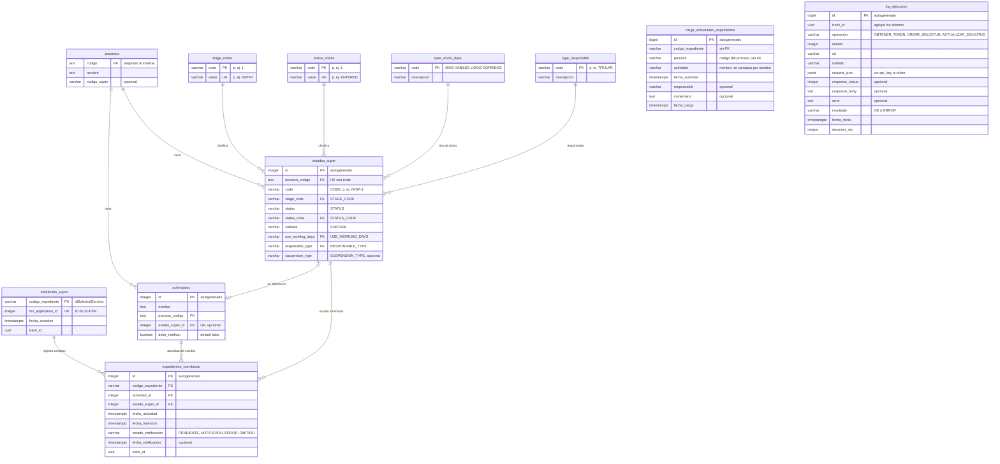

# ms-integracion-super

Servicio construido con **Next.js 16 (App Router)**, **React 19** y **TypeScript**. Expone endpoints REST documentados con OpenAPI y páginas de presentación para el usuario.

## Requisitos

- Node.js 22.12 o superior (lo exige Vitest 5)
- [pnpm](https://pnpm.io) (la versión está fijada en `packageManager` de `package.json`)

## Comandos

```bash
pnpm install              # instala dependencias
pnpm dev                  # aplica las migraciones pendientes y levanta el servidor en http://localhost:3000/ms-integracion-super
pnpm build                # build de producción (incluye verificación de tipos)
pnpm start                # sirve el build de producción
pnpm exec tsc --noEmit    # solo verificación de tipos
pnpm test                 # tests unitarios con Vitest en modo watch
pnpm test --run           # tests unitarios una vez
pnpm test:integration     # tests de integración contra la API real de Mi Súper
```

### Tests

Los tests (`*.test.ts`) están en la carpeta `tests/`, separados en dos grupos que replican la estructura de `src/`:

- **`tests/unit/`**: no usan red ni el `.env`. Los servicios reciben dependencias falsas y las variables se definen con `vi.stubEnv`.
- **`tests/integration/`**: llaman a los servicios reales con las variables del `.env`, que apunta al ambiente de QA de Mi Súper.

El test que crea una solicitud en Mi Súper se omite por defecto, para no llenar QA de registros en cada ejecución. Para ejecutarlo:

1. Completa `tests/integration/fixtures/crear-solicitud-request.fixture.ts` con datos válidos.
2. Ejecuta `MISUPER_INTEGRATION_CREAR_SOLICITUD=true pnpm test:integration`.

## Base de datos

PostgreSQL con [Drizzle ORM](https://orm.drizzle.team). Todas las tablas viven en el esquema `super`, incluido el historial de migraciones (`super.__drizzle_migrations`). Las tablas se definen en `src/core/repository/entity/` y las consultas en `src/core/repository/dao/`.

```bash
pnpm db:generate --name <cambio>   # genera la migración SQL a partir de las entidades
pnpm db:migrate                    # aplica las migraciones pendientes en DATABASE_URL
pnpm db:studio                     # explorador web de la base de datos
```

`pnpm dev` ejecuta `db:migrate` antes de levantar el servidor. `pnpm start` no lo hace: en cada despliegue hay que ejecutar `pnpm db:migrate` antes de iniciar la aplicación.

La carpeta `drizzle/` es el historial de migraciones y se versiona en git. Cada cambio de esquema se hace modificando las entidades y ejecutando `db:generate`.

### Modelo entidad-relación

`carga_actividades_expedientes` aparece sin relaciones porque no tiene FK: es la tabla de entrada de la carga diaria.



### Tablas

Las tablas se agrupan en cinco áreas: proceso interno, configuración de SUPER, carga diaria, expedientes y trazabilidad.

**Proceso interno**

| Tabla | Columnas | Notas |
|---|---|---|
| `procesos` | `codigo` (PK), `nombre`, `codigo_super` (opcional) | El código se asigna al insertar. `codigo_super` es el código del proceso en SUPER; null mientras no esté configurado. Se llamaba `nombre_super` hasta la migración `0015`, que solo renombró la columna |
| `actividades` | `id` (PK autogenerada), `nombre`, `proceso_codigo` (FK), `estado_super_id` (FK, único, opcional), `debe_notificar` (booleano, `false` por defecto) | Cada actividad pertenece a un único proceso. `estado_super_id` es el estado SUPER que se informa cuando un expediente pasa por ella; si es null, la actividad no se informa. `debe_notificar` indica si la actividad se envía al servicio de notificación, que es independiente de SUPER; lo agregó la migración `0014`, en `false` para todas |

**Configuración de SUPER**

| Tabla | Columnas | Notas |
|---|---|---|
| `estados_super` | `id` (PK autogenerada), `proceso_codigo` (FK a `procesos`), `code`, `stage_code` (FK), `status`, `status_code` (FK), `subtask`, `use_working_days` (FK), `responsible_type` (FK), `suspension_type` | Estados que se informan a SUPER. Las columnas en inglés son los campos del manual de SUPER y se guardan sin validar formato |
| `stage_codes` | `code` (PK), `value` (único) | Catálogo de `STAGE_CODE`, por ejemplo `1` → `ENTRY` |
| `status_codes` | `code` (PK), `value` (único) | Catálogo de `STATUS_CODE`, por ejemplo `1` → `ENTERED` |
| `type_works_days` | `code` (PK), `descripcion` | Catálogo de `USE_WORKING_DAYS`: `DÍAS HÁBILES` y `DÍAS CORRIDOS`. A diferencia de `stage_codes` y `status_codes`, `code` es el mismo valor que se envía a SUPER |
| `type_responsible` | `code` (PK), `descripcion` | Catálogo de `RESPONSIBLE_TYPE`: `TITULAR`, `ORGANO_SECTORIAL` y `ORGANO_INFORMANTE`. Como en `type_works_days`, `code` es el valor que se envía a SUPER |

**Carga diaria**

| Tabla | Columnas | Notas |
|---|---|---|
| `carga_actividades_expedientes` | `id` (PK autogenerada), `codigo_expediente`, `proceso`, `actividad`, `fecha_actividad`, `responsable`, `comentario`, `fecha_carga` | Movimientos de actividad que un procedimiento externo carga cada día. Es solo de entrada y no tiene FK, para que una carga con datos desconocidos no falle. `proceso` es el código del proceso y `actividad` el nombre de la actividad: la actividad se identifica por ambos, no por id. Único por `codigo_expediente`, `actividad`, `fecha_actividad` |

**Expedientes**

| Tabla | Columnas | Notas |
|---|---|---|
| `solicitudes_super` | `codigo_expediente` (PK), `ms_application_id` (único), `fecha_creacion`, `track_id` | Solicitud creada en SUPER para cada expediente (1:1). La llena `POST /api/super/solicitudes` cuando SUPER responde OK |
| `expedientes_tramitando` | `id` (PK autogenerada), `codigo_expediente` (FK), `actividad_id` (FK), `estado_super_id` (FK), `fecha_actividad`, `fecha_insercion`, `estado_notificacion`, `fecha_notificacion`, `track_id` | Historial de cambios de actividad de cada expediente. Solo se inserta cuando la actividad cambió |

**Trazabilidad**

| Tabla | Columnas | Notas |
|---|---|---|
| `log_ejecucion` | `id` (PK autogenerada), `track_id`, `operacion`, `intento`, `url`, `metodo`, `request_json`, `response_status`, `response_body`, `error`, `resultado`, `fecha_inicio`, `duracion_ms` | Una fila por cada llamada HTTP a SUPER |

### Reglas

**Configuración de SUPER**

- Cada estado SUPER pertenece a un proceso de `procesos` (antes existía una tabla aparte, `procesos_super`, que se integró en `procesos` con las migraciones `0010` a `0012`).
- `estados_super.code` es único dentro de cada proceso: el mismo código puede repetirse en otro proceso.
- `stage_code` y `status_code` solo aceptan códigos registrados en `stage_codes` y `status_codes`, y guardan el código interno (`"1"`), no el valor (`ENTRY`). `use_working_days` y `responsible_type` solo aceptan códigos de `type_works_days` y `type_responsible`.
- Las FK de `estados_super` usan `ON UPDATE CASCADE` (si cambia un código, los estados lo siguen) y `ON DELETE RESTRICT` (no se puede borrar un proceso ni un código en uso).
- Una actividad y un estado SUPER se relacionan 1:1: una actividad tiene como máximo un estado SUPER (`actividades.estado_super_id`) y un estado SUPER pertenece a una sola actividad (restricción única). El estado debe ser del mismo proceso que la actividad (lo valida `PUT /api/actividades/{id}/estado-super`). La FK usa `ON DELETE RESTRICT`: no se puede borrar un estado asignado a una actividad.

**Carga diaria**

- El procedimiento externo carga solo el último movimiento de cada expediente. Si un expediente se movió dos veces en el día, solo se informa la última actividad.
- Si la tabla acumula varias cargas, el job toma solo el movimiento más reciente de cada expediente.
- El job compara la actividad cargada con la última de `expedientes_tramitando` **por nombre**, no por `id`. El `id` es interno y un cambio de flujo puede darle otro a la misma actividad.
- El job busca la actividad en `actividades` por `proceso` + `actividad` (código del proceso y nombre). Si no existe, el movimiento se omite y queda un aviso en la consola.
- Un expediente sin registros en `expedientes_tramitando` siempre cuenta como cambio.

**Expedientes**

- Un expediente tiene una sola solicitud en SUPER, y un `ms_application_id` pertenece a un solo expediente.
- `expedientes_tramitando` no acepta dos veces el mismo cambio (`codigo_expediente`, `actividad_id`, `fecha_actividad`) ni expedientes sin solicitud en `solicitudes_super`.
- `estado_notificacion` vale `PENDIENTE` (por defecto), `NOTIFICADO`, `ERROR` u `OMITIDO`.

**Trazabilidad**

- `track_id` une las tablas de negocio con `log_ejecucion` **sin FK**, para que la trazabilidad no condicione al negocio. Los reintentos de una misma operación comparten `track_id`.
- `log_ejecucion` nunca guarda el `api_key` ni el token de SUPER: ambos se reemplazan por `***`.

### Datos iniciales

- La migración `0002` carga los códigos del manual, numerados en su orden:
  - 4 en `stage_codes`, de `1` → `ENTRY` a `4` → `FINISHED`;
  - 14 en `status_codes`, de `1` → `ENTERED` a `14` → `CLOSED`.

  Los que SUPER agregue después los ingresa el usuario.
- La migración `0013` agrega a `status_codes` tres valores que no están en el manual y que usan los estados SUPER del proceso `9`: `15` → `SENDED`, `16` → `RECEIVED` y `17` → `FINISHED`.
- Las migraciones `0016` a `0018` crean `type_works_days`, cargan `DÍAS HÁBILES` y `DÍAS CORRIDOS` (los valores que ya usaban los estados existentes) y recién entonces agregan la FK desde `estados_super.use_working_days`. Las migraciones `0019` a `0021` hacen lo mismo con `type_responsible` (`TITULAR`, `ORGANO_SECTORIAL`, `ORGANO_INFORMANTE`) y `estados_super.responsible_type`.
- La migración `0004` carga el proceso `9` → `Concesion OLP` en `procesos` y sus 26 actividades en `actividades`, desde `Ingresar Solicitud` hasta `Ingresa datos CEE y valor renta concesional fijada`. Los `id` de las actividades los asigna la identidad en el orden de la lista.
- La migración `0006` agrega otras 13 actividades al proceso `9`, desde `Firma Seremi` hasta `Recibir Notificación - Resolución`.
- La migración `0011` copia el nombre de `procesos_super` a `procesos.nombre_super`, hoy `codigo_super` (el proceso `9` queda con `Concesión onerosa de largo plazo`). Falla si un proceso SUPER no tiene un proceso con el mismo código, en vez de perder datos.
- El resto de las tablas no tiene carga inicial. `procesos.codigo_super` se configura con `PATCH /api/procesos/{codigo}`, `estados_super` con `POST /api/procesos/{codigo}/estados-super` y `actividades.estado_super_id` con `PUT /api/actividades/{id}/estado-super`. Las actividades y los estados SUPER también se agregan y modifican desde la interfaz, en `/procesos/{codigo}`.

## Docker

La carpeta `cicd/` contiene el `Dockerfile` de producción. Usa la salida `standalone` de Next.js (`output: "standalone"` en `next.config.ts`), así que la imagen solo lleva `server.js` y las dependencias que realmente se usan. Se construye desde la raíz del repositorio:

```bash
docker build -f cicd/Dockerfile -t ms-integracion-super .
docker run -p 3000:3000 --env-file .env ms-integracion-super
```

- Con `DB_MIGRAR_AL_INICIAR=true` (el valor por defecto), al iniciar el contenedor crea el esquema `super` y aplica las migraciones pendientes (`cicd/migrate.mjs`, con el migrador de `drizzle-orm`) y después levanta el servidor. Si las migraciones fallan, el contenedor no arranca. Un *advisory lock* de PostgreSQL evita que varias réplicas migren a la vez: una migra y las demás esperan.
- Las variables de entorno se entregan al ejecutar el contenedor. La imagen no incluye el `.env` (lo excluye `cicd/Dockerfile.dockerignore`).
- Con `DB_MIGRAR_AL_INICIAR=false` el contenedor no toca la base de datos, por ejemplo cuando las migraciones se ejecutan en un paso aparte del pipeline.
- Dentro del contenedor, `localhost` es el propio contenedor. Para usar el PostgreSQL de tu máquina, cambia el host de `DATABASE_URL` por `host.docker.internal`.

### Docker Compose

`cicd/docker-compose.yml` levanta la aplicación junto a un PostgreSQL 17 propio, con sus datos en un volumen:

```bash
docker compose -f cicd/docker-compose.yml --env-file .env up --build -d   # levanta todo
docker compose -f cicd/docker-compose.yml --env-file .env logs -f app     # logs de la aplicación
docker compose -f cicd/docker-compose.yml --env-file .env down            # detiene (agrega -v para borrar los datos)
```

- La aplicación espera a que PostgreSQL esté listo y, con `DB_MIGRAR_AL_INICIAR=true`, crea el esquema y las tablas antes de aceptar peticiones.
- El `DATABASE_URL` del `.env` no se usa: el compose lo arma para apuntar al servicio `db`.
- `HOST_SUPER`, `PATH_TOKEN_SUPER`, `PATH_APPLICATIONS_SUPER` y las `MISUPER_*` son obligatorias; si falta alguna, el compose no arranca y dice cuál.
- Variables opcionales y sus valores por defecto: `DB_MIGRAR_AL_INICIAR=true`, `APP_PORT=3000`, `POSTGRES_USER=postgres`, `POSTGRES_PASSWORD=postgres`, `POSTGRES_DB=ms_integracion_super` y `POSTGRES_PORT=5435` (el puerto de PostgreSQL en tu máquina).

## Variables de entorno

Copia `.env.example` a `.env` y completa los valores. El código accede a ellas solo a través de `EnvConfig` (`src/config/env.config.ts`). Si falta una variable, se lanza un error con su nombre al usarla.

Las URL de Mi Súper se arman como `HOST_SUPER` + `PATH_*`: `PATH_TOKEN_SUPER` para el token y `PATH_APPLICATIONS_SUPER` para crear y actualizar solicitudes.

Las variables del SSO de Azure (`AZURE_AD_*`, `SESION_*`) se describen en [Autenticación con el SSO de Azure](#autenticación-con-el-sso-de-azure).

## Arquitectura

El proyecto usa una **arquitectura en capas simplificada**. Se eligió a propósito en lugar de Clean Architecture completa (casos de uso, puertos, contenedor de dependencias), porque el proyecto no será grande.

### Flujo de una petición

```
Cliente HTTP
    │
    ▼
app/api/<endpoint>/route.ts      Capa de exposición: valida la entrada (Zod) y arma la respuesta HTTP
    │
    ▼
service/<feature>/*.service.ts   Capa de servicio: orquesta la lógica y llama a los repositorios
    │
    ▼
core/repository/dao/*.dao.ts     Capa de datos: consultas a PostgreSQL con Drizzle

core/domain/<feature>/           Dominio: entidades, reglas de negocio y errores; lo pueden usar todas las capas
```

Las dependencias van en un solo sentido: `api → service → repository`. Una capa nunca importa a la capa que está por encima.

### Estructura de carpetas

```
src/
├── app/
│   ├── (presentacion)/          Capa de presentación: páginas para el usuario
│   │   ├── components/          Componentes de la interfaz (sin URL: no tienen page.tsx)
│   │   │   ├── fragments/       Contenido de cada página (login, portal, procesos, ejecuciones)
│   │   │   ├── ui/              Componentes reutilizables: Tabla, Badge, Boton, BotonLink, Buscador, FiltroSelect,
│   │   │   │                    Pestanas, Paginacion, Modal, FormularioModal, Campo, Casilla, BloqueCodigo
│   │   │   ├── layout/          Estructura de las páginas privadas: AppShell, Header, Sidebar, UserMenu,
│   │   │   │                    Breadcrumb, PageHeader y menu.ts (opciones del menú)
│   │   │   └── hooks/           Hooks compartidos (useIsMobile, useParametrosUrl)
│   │   ├── (pages)/             Páginas (route group: no aparece en la URL)
│   │   │   ├── login/           → /ms-integracion-super/login
│   │   │   └── (private)/       Páginas que exigen sesión (route group: no aparece en la URL)
│   │   │       ├── layout.tsx   Cabecera y menú lateral de todas las páginas privadas
│   │   │       ├── portal/      → /ms-integracion-super/portal
│   │   │       ├── procesos/    → /ms-integracion-super/procesos y /procesos/{codigo}
│   │   │       └── ejecuciones/ → /ms-integracion-super/ejecuciones y /ejecuciones/{id}
│   │   └── page.tsx             → raíz de la app: redirige a /portal o a /login
│   ├── api/                     Capa de exposición: endpoints REST
│   │   ├── actividades/         Asignación del estado SUPER de cada actividad
│   │   ├── auth/                Login, callback, logout y sesión del SSO de Azure
│   │   ├── procesos/            Procesos, sus actividades y sus estados SUPER
│   │   ├── super/stage-codes/   Catálogo STAGE_CODE
│   │   ├── super/status-codes/  Catálogo STATUS_CODE
│   │   ├── super/type-works-days/  Catálogo USE_WORKING_DAYS
│   │   ├── super/type-responsible/  Catálogo RESPONSIBLE_TYPE
│   │   ├── super/solicitudes/
│   │   │   ├── route.ts         Handler HTTP
│   │   │   └── solicitudes.schema.ts  Contrato: esquemas Zod y registro OpenAPI
│   │   ├── openapi/             Especificación OpenAPI generada (/api/openapi)
│   │   └── docs/                Documentación interactiva (/api/docs)
│   ├── auth/                    Cookies de sesión y redirecciones del SSO (sin URL)
│   ├── job/                     Jobs programados (sin URL)
│   ├── layout.tsx               Layout raíz (Next.js lo exige aquí)
│   ├── globals.css
│   └── favicon.ico              (Next.js lo exige aquí)
├── config/
│   ├── env.config.ts            Acceso a las variables de entorno (EnvConfig)
│   └── db.config.ts             Conexión a PostgreSQL (Drizzle)
├── core/
│   ├── domain/                  Clases de dominio y reglas de negocio
│   └── repository/              Acceso a datos
│       ├── entity/              Tablas (una entidad por archivo) y relaciones
│       └── dao/                 Consultas sobre cada entidad
└── service/                     Servicios de orquestación
drizzle/                         Historial de migraciones SQL (generado con pnpm db:generate)
cicd/                            Dockerfile, docker-compose.yml y script de migraciones del contenedor
```

### Responsabilidades por capa

| Capa | Ubicación | Responsabilidad | No debe |
|---|---|---|---|
| Presentación | `src/app/(presentacion)/` | Páginas que ve el usuario | — |
| Exposición | `src/app/api/` | Validar la petición con Zod, llamar al servicio, armar la respuesta y convertir errores en códigos HTTP | Contener lógica de negocio |
| Servicio | `src/service/` | Orquestar: llamar a los repositorios y aplicar las reglas del dominio | Conocer `Request`/`Response` ni nada de HTTP |
| Repositorio | `src/core/repository/` | Obtener y guardar datos | Contener lógica de negocio |
| Dominio | `src/core/domain/` | Entidades, reglas de negocio y errores de dominio | Depender de otras capas o de Next.js |

### Interfaz

- Estilos con **Tailwind CSS v4** (`postcss.config.mjs` y `@import "tailwindcss"` en `src/app/globals.css`). En `globals.css` se definen `font-gob` (usa Geist mientras no se cargue la tipografía gob.cl) y `franja-gob` (franja azul y roja del Gobierno de Chile). Los estilos globales propios van dentro de `@layer base`: fuera de una capa le ganarían a las clases de Tailwind.
- La página `/login` muestra `LoginFragment`. Su botón "Sign in with Microsoft" navega a `/api/auth/login?returnTo=`, y si el callback vuelve con `?error=` muestra el mensaje correspondiente.
- Páginas privadas: `(private)/layout.tsx` las envuelve en `AppShell`, con una cabecera arriba (botón para ocultar o mostrar el menú y el nombre del Ministerio) y el menú lateral a la izquierda (marca, opciones y el usuario con "Cerrar sesión"). En móvil el menú se abre encima del contenido. Cada página parte con `PageHeader` (ruta de navegación, título y descripción).
- **Procesos** (`/procesos`): tabla con código, nombre y código en SUPER de cada proceso, con búsqueda. "Ver actividades" abre `/procesos/{codigo}`: un resumen (código, código en SUPER, cantidad de actividades y cuántas informan a SUPER) y dos pestañas, que quedan en `?tab=` de la URL:
  - **Actividades** (por defecto): las actividades en el orden del flujo, con el estado SUPER de cada una (`code`, status, etapa, status SUPER y responsable) o "No informa". "Agregar actividad" la crea al final del flujo y "Editar" cambia su nombre, su estado SUPER (o la deja sin informar) y la casilla "Debe notificar" (columna "Notifica"), que es para el servicio de notificación y no depende de SUPER. El nombre no puede repetirse en el proceso, porque la carga diaria (`carga_actividades_expedientes`) identifica la actividad por proceso + nombre: si se cambia, las cargas deben usar el nombre nuevo. Cada estado SUPER se asigna a una sola actividad; los que ya tiene otra aparecen deshabilitados.
  - **Estados SUPER**: las séxtuplas del proceso con la actividad a la que están asignadas o "Sin asignar". "Agregar estado SUPER" y "Editar" usan las mismas reglas que `POST /api/procesos/{codigo}/estados-super` (obligatorios, largos, catálogos y `code` único en el proceso); stage code y status code se eligen de sus catálogos.

  Las páginas leen los datos llamando a los servicios desde el servidor, no a través de la API HTTP, y guardan con Server Actions (`procesos/[codigo]/acciones.ts`) que exigen sesión y llaman a `ProcesoService` y `ConfiguracionSuperService`. Los errores de negocio se muestran en el formulario, que conserva lo escrito. La búsqueda queda en `?q=` de la URL, así se puede compartir o recargar.
- **Traza ejecuciones** (`/ejecuciones`): la tabla `log_ejecucion`, una fila por llamada HTTP a SUPER, de la más reciente a la más antigua. Muestra fecha, operación, método y ruta, status HTTP ("Sin respuesta" si no hubo), resultado (Correcta/Fallida), duración y track ID. Tiene pestañas Todas / Correctas / Fallidas con su cantidad (`?resultado=OK|ERROR`), filtro por operación (`?operacion=`), búsqueda por track ID o URL (`?q=`) y paginación de 20 (`?pagina=`). Como la tabla crece con cada llamada, el filtro y la paginación se hacen en la base de datos. "Ver detalle" abre `/ejecuciones/{id}`: los datos de la llamada, el request enviado y la respuesta de SUPER (formateados si son JSON), el error cuando no hubo respuesta HTTP y las demás llamadas con el mismo track ID (por ejemplo el token y la creación de la solicitud). La api key y el token ya se enmascaran al guardar, así que no aparecen. La lee `TrazaService` (`src/service/traza/`).

  La pestaña **Limpieza** (`?tab=limpieza`) elimina trazas para liberar espacio en la base de datos. El usuario elige un rango de días (desde y hasta, ambos incluidos, en hora de Chile) y "Revisar" muestra cuántas trazas hay en él (`?desde=&hasta=`). "Eliminar N trazas" pide confirmación en un modal y las borra con la Server Action `eliminarTrazas` (`ejecuciones/acciones.ts`), que exige sesión, vuelve a validar el rango y deja en el log del servidor quién limpió, qué rango y cuántas eliminó. Reglas del dominio (`core/domain/traza/limpieza.ts`): las dos fechas son obligatorias y deben ser días reales, desde no puede ser posterior a hasta y hasta no puede ser posterior a hoy. Se eliminan correctas y fallidas, y no se puede deshacer.
- Para agregar una opción al menú basta con sumarla a `MENU` en `components/layout/menu.ts` (`label`, `href`, ícono de `lucide-react` y `descripcion`); aparece en el menú lateral y como tarjeta en el portal. Hoy las opciones son **Procesos** y **Traza ejecuciones**.
- Validación de sesión:

  | Página | Sin sesión | Con sesión |
  |---|---|---|
  | `/` | redirige a `/login` | redirige a `/portal` |
  | `/login` | muestra el login | redirige a `/portal` |
  | `/portal` y toda página de `(private)` | redirige a `/login` | muestra la página |

  Cada página de `(private)` llama a `requerirUsuario()` (`src/app/auth/sesion.ts`), que devuelve el usuario o redirige a `/login`. Se llama en cada página y no en un layout, porque el layout no se vuelve a renderizar al navegar entre páginas. Después del login se vuelve a `/portal` (o al `returnTo` recibido); "Cerrar sesión" vuelve a `/login`.
- Las imágenes van en `public/assets/img/` y se referencian con `BASE_PATH`. Falta agregar `logotipo-bienes-nacionales.png`.

### basePath `/ms-integracion-super`

Toda la app se sirve bajo `/ms-integracion-super` (`basePath` en `next.config.ts`, con el valor de `src/config/base-path.ts`), para identificarla cuando comparte host con otras aplicaciones. La raíz `/` del host no responde. En este README las rutas de los endpoints (`/api/...`) se escriben sin el prefijo; la URL completa es, por ejemplo, `http://localhost:3000/ms-integracion-super/api/procesos`.

Next.js fija el basePath al compilar, por eso es una constante y no una variable de entorno: cambiarlo exige un nuevo build. Next lo agrega solo en `<Link>`, `redirect()` y el router. En el resto se agrega con `BASE_PATH`:

- `Response.redirect` en los Route Handlers (`src/app/auth/redireccion.ts`).
- El path de las cookies, para que las otras apps del mismo host no las reciban.
- El `src` de `next/image` y cualquier URL de `public/`.
- Las URL absolutas que se entregan a terceros: la Redirect URI de Azure, el `server` de OpenAPI y la URL de la especificación que carga Scalar.

### Sobre `(presentacion)`

En Next.js cada carpeta dentro de `app/` forma parte de la URL. Los paréntesis convierten la carpeta en un **route group**: sirve para organizar, pero no aparece en la URL. Así, `(presentacion)/page.tsx` se sirve en la raíz de la app (`/ms-integracion-super`) y `(presentacion)/productos/page.tsx` en `/ms-integracion-super/productos`. Si se quitan los paréntesis, todas las páginas pasan a estar bajo `/presentacion`. Lo mismo vale para `(pages)` y `(private)`: `(pages)/login/page.tsx` se sirve en `/ms-integracion-super/login`, que es donde el callback del SSO redirige con `?error=`. Sin paréntesis quedaría en `/ms-integracion-super/pages/login`.

## Endpoints

| Método | Ruta | Descripción |
|---|---|---|
| `GET` | `/api/procesos` | Lista los procesos cargados |
| `PATCH` | `/api/procesos/{codigo}` | Actualiza el código SUPER de un proceso |
| `GET` | `/api/procesos/{codigo}/actividades` | Lista las actividades de un proceso, cada una con su estado SUPER |
| `GET` | `/api/procesos/{codigo}/estados-super` | Lista los estados SUPER configurados para un proceso |
| `POST` | `/api/procesos/{codigo}/estados-super` | Crea un estado SUPER (séxtupla) en un proceso, sin asignarlo a una actividad |
| `PUT` | `/api/actividades/{id}/estado-super` | Asigna un estado SUPER existente a una actividad |
| `GET` | `/api/super/stage-codes` | Lista el catálogo de `STAGE_CODE` |
| `GET` | `/api/super/status-codes` | Lista el catálogo de `STATUS_CODE` |
| `GET` | `/api/super/type-works-days` | Lista el catálogo de `USE_WORKING_DAYS` |
| `GET` | `/api/super/type-responsible` | Lista el catálogo de `RESPONSIBLE_TYPE` |
| `POST` | `/api/super/solicitudes` | Recibe una solicitud y la crea en Mi Súper de forma asíncrona |
| `GET` | `/api/auth/login` | Inicia el login con el SSO de Azure |
| `GET` | `/api/auth/callback` | Callback del SSO de Azure (Redirect URI) |
| `GET` | `/api/auth/logout` | Cierra la sesión de la app (no la de Microsoft) |
| `GET` | `/api/auth/sesion` | Usuario de la sesión actual |
| `GET` | `/api/openapi` | Especificación OpenAPI 3.1 en JSON |
| `GET` | `/api/docs` | Documentación interactiva de la API (Scalar) |

### `GET /api/procesos`

Devuelve todos los procesos ordenados por código. `codigoSuper` es `null` mientras el proceso no esté configurado en SUPER.

```json
[{ "codigo": "9", "nombre": "Concesion OLP", "codigoSuper": "CONCESION_OLP" }]
```

### `PATCH /api/procesos/{codigo}`

Actualiza el código SUPER del proceso. Los procesos se crean por semilla, así que este endpoint no crea ni cambia `codigo` ni `nombre`. El valor se guarda sin espacios al inicio ni al final; `null` o vacío lo quita.

```bash
curl -X PATCH http://localhost:3000/ms-integracion-super/api/procesos/9 \
  -H 'Content-Type: application/json' -d '{"codigoSuper":"CONCESION_OLP"}'
```

| Estado | Cuándo |
|---|---|
| 200 | Proceso actualizado; responde `{ codigo, nombre, codigoSuper }` |
| 400 | El cuerpo no es JSON, no trae `codigoSuper` (texto o `null`) o supera 150 caracteres |
| 404 | El proceso no existe |

### `GET /api/procesos/{codigo}/actividades`

Devuelve las actividades del proceso en el orden en que se crearon, cada una con el estado SUPER que se informa cuando un expediente pasa por ella (`actividades.estado_super_id`). Las que no informan a SUPER vienen con `estadoSuper: null`, lo que sirve para revisar qué falta configurar. `estadoSuper` tiene la misma forma que en `GET /api/procesos/{codigo}/estados-super`. `debeNotificar` indica si la actividad se envía al servicio de notificación, independiente de SUPER.

```json
[
  { "id": 3, "nombre": "Ingresar Solicitud", "procesoCodigo": "9",
    "estadoSuper": { "id": 1, "code": "IWSP-1", "stageValue": "ENTRY", "statusValue": "ENTERED", "...": "..." },
    "debeNotificar": true },
  { "id": 4, "nombre": "Ingresar Documentacion", "procesoCodigo": "9", "estadoSuper": null, "debeNotificar": false }
]
```

| Estado | Cuándo |
|---|---|
| 200 | El proceso existe. Si no tiene actividades, devuelve `[]` |
| 400 | El código viene vacío |
| 404 | El proceso no existe |

### `GET /api/procesos/{codigo}/estados-super`

Devuelve los estados (séxtuplas) configurados para el proceso, en el orden en que se crearon, estén o no asignados a una actividad. Junto a `stageCode` y `statusCode`, que son los códigos internos de los catálogos, vienen `stageValue` y `statusValue` con el valor que usa SUPER, y junto a `useWorkingDays` y `responsibleType` vienen `useWorkingDaysDescripcion` y `responsibleTypeDescripcion`.

```json
[{
  "id": 1, "procesoCodigo": "9", "code": "IWSP-1",
  "stageCode": "1", "stageValue": "ENTRY",
  "status": "Solicitud ingresada", "statusCode": "1", "statusValue": "ENTERED",
  "subtask": "Solicitud recibida", "useWorkingDays": "DÍAS HÁBILES",
  "useWorkingDaysDescripcion": "Plazo en días hábiles: lunes a viernes, sin feriados",
  "responsibleType": "TITULAR", "responsibleTypeDescripcion": "El titular de la solicitud",
  "suspensionType": null
}]
```

| Estado | Cuándo |
|---|---|
| 200 | El proceso existe. Si no tiene estados, devuelve `[]` |
| 400 | El código viene vacío |
| 404 | El proceso no existe |

### `POST /api/procesos/{codigo}/estados-super`

Crea una séxtupla en el proceso. Queda sin actividad; se asigna después con `PUT /api/actividades/{id}/estado-super`. Los campos se guardan tal como los define SUPER: solo se valida que vengan y quepan en su columna.

| Campo | Requerido | Largo máximo | Notas |
|---|---|---|---|
| `code` | Sí | 20 | Único dentro del proceso, por ejemplo `IWSP-1` |
| `stageCode` | Sí | 50 | Código interno de `stage_codes` (por ejemplo `"1"` para `ENTRY`) |
| `status` | Sí | 150 | |
| `statusCode` | Sí | 50 | Código interno de `status_codes` (por ejemplo `"1"` para `ENTERED`) |
| `subtask` | Sí | 255 | |
| `useWorkingDays` | Sí | 50 | Código de `type_works_days`: `DÍAS HÁBILES` o `DÍAS CORRIDOS` |
| `responsibleType` | Sí | 50 | Código de `type_responsible`: `TITULAR`, `ORGANO_SECTORIAL` u `ORGANO_INFORMANTE` |
| `suspensionType` | No | 10 | Causal de suspensión; vacío o `null` es sin causal |

```bash
curl -X POST http://localhost:3000/ms-integracion-super/api/procesos/9/estados-super \
  -H 'Content-Type: application/json' \
  -d '{"code":"IWSP-1","stageCode":"1","status":"Solicitud ingresada","statusCode":"1",
       "subtask":"Solicitud recibida","useWorkingDays":"DÍAS HÁBILES","responsibleType":"TITULAR"}'
```

| Estado | Cuándo |
|---|---|
| 201 | Estado creado; responde con la misma forma que `GET /api/procesos/{codigo}/estados-super` |
| 400 | El cuerpo no es JSON, falta un campo o supera su largo |
| 404 | El proceso no existe |
| 409 | El proceso ya tiene un estado con ese `code` |
| 422 | `stageCode`, `statusCode`, `useWorkingDays` o `responsibleType` no existen en su catálogo |

### `PUT /api/actividades/{id}/estado-super`

Asigna un estado SUPER existente (de `estados_super`) a la actividad, guardándolo en `actividades.estado_super_id`. El estado debe ser del mismo proceso que la actividad. Si la actividad ya tenía un estado, lo reemplaza. Repetir la misma asignación no falla.

```bash
curl -X PUT http://localhost:3000/ms-integracion-super/api/actividades/3/estado-super \
  -H 'Content-Type: application/json' -d '{"estadoSuperId": 1}'
```

Responde `200` con la actividad y su estado, con la misma forma que cada elemento de `GET /api/procesos/{codigo}/actividades`.

| Estado | Cuándo |
|---|---|
| 400 | El id no es un entero positivo, o el cuerpo no es JSON o no trae `estadoSuperId` válido |
| 404 | La actividad no existe |
| 409 | El estado SUPER ya está asignado a otra actividad (la relación es 1:1) |
| 422 | El estado SUPER no existe o es de otro proceso |

Para configurar un proceso: poner su código SUPER (`PATCH /api/procesos/{codigo}`), crear sus estados (`POST /api/procesos/{codigo}/estados-super`) y asignar cada uno a su actividad (`PUT /api/actividades/{id}/estado-super`).

### `GET /api/super/stage-codes` y `GET /api/super/status-codes`

Devuelven los catálogos `stage_codes` y `status_codes`. `code` es el código interno que guarda `estados_super`, y `value` es el valor que usa SUPER.

```json
[{ "code": "1", "value": "ENTRY" }, { "code": "2", "value": "ADMISSIBILITY" }]
```

El orden es por `code` como texto, así que en `status-codes` el `10` aparece antes que el `2`.

### `GET /api/super/type-works-days` y `GET /api/super/type-responsible`

Devuelven los catálogos `type_works_days` y `type_responsible`, ordenados por `code`. El `code` es el valor que guardan `estados_super.use_working_days` y `estados_super.responsible_type`, y el que se envía a SUPER.

```json
[{ "code": "DÍAS CORRIDOS", "descripcion": "Plazo en días corridos: todos los días del calendario" },
 { "code": "DÍAS HÁBILES", "descripcion": "Plazo en días hábiles: lunes a viernes, sin feriados" }]
```

### `POST /api/super/solicitudes`

Recibe una solicitud y la crea en Mi Súper de forma **asíncrona**. Responde `202` apenas la petición pasa las validaciones. La llamada a Mi Súper se ejecuta después de responder, con `after()` de Next.js. El contrato está en camelCase; el servicio lo traduce al formato snake_case que espera Mi Súper.

Antes de responder se comprueba que el proceso exista y tenga `codigo_super`. Después de responder, el servicio:

1. vuelve a leer el `codigo_super` del proceso, que es el trámite (`procedure_id`) en Mi Súper;
2. pide el token y crea la solicitud en Mi Súper, registrando cada llamada en `log_ejecucion` con el `trackId` de la respuesta (sin el `api_key` ni el token);
3. si Mi Súper responde OK, guarda `idSolicitudServicio` → `ms_application_id` en `solicitudes_super`.

Si Mi Súper rechaza la solicitud o no está disponible, quien llamó al endpoint no se entera: el resultado se consulta en `log_ejecucion` por `trackId`. Todavía no hay reintentos, y si el contenedor se detiene justo después de responder, esa solicitud no se envía.

**Cuerpo** (`application/json`)

| Campo | Tipo | Requerido | En Mi Súper |
|---|---|---|---|
| `codigoProceso` | string | Sí | `procedure_id`: se envía el `codigo_super` del proceso (tabla `procesos`), no el código recibido |
| `idSolicitudServicio` | string (máx. 50) | Sí | `service_application_id`. Es el código del expediente en nuestro sistema (`codigo_expediente`); un expediente admite una sola solicitud |
| `beneficiario` | `{ tipo, rut, email }` | Sí | `principal { type, rut, email }`: titular de la solicitud, por ejemplo `tipo: "company"` |
| `creador` | `{ rut, nombre, apellido, email }` | Sí | `creator { rut, first_name, last_name, email }`: quien crea la solicitud |
| `cup` | string | No | `cup`. Si se omite se envía `""` |

```bash
curl -X POST http://localhost:3000/ms-integracion-super/api/super/solicitudes \
  -H 'Content-Type: application/json' \
  -d '{"codigoProceso":"9","idSolicitudServicio":"ABCDEFG",
       "beneficiario":{"tipo":"company","rut":"77762937-5","email":"contacto@constructoradelsur.cl"},
       "creador":{"rut":"13762927-5","nombre":"Ignacio","apellido":"Perez","email":"ignacio.perez@example.cl"},
       "cup":"MTPDND55"}'
```

**Respuestas**

`202 Accepted`

```json
{ "trackId": "4926fd1b-4b1d-4f46-a8e2-7e44bb8956d9", "mensaje": "Solicitud recibida; se enviará a Mi Súper" }
```

| Estado | Cuándo |
|---|---|
| `400` | El cuerpo no es JSON o no cumple el contrato. El mensaje indica el campo (`codigoProceso: ...`) |
| `404` | El proceso (`codigoProceso`) no existe |
| `409` | El expediente (`idSolicitudServicio`) ya tiene una solicitud en `solicitudes_super` |
| `422` | El proceso no tiene `codigo_super` configurado (se configura con `PATCH /api/procesos/{codigo}`) |

Para ver qué pasó con una solicitud:

```sql
SELECT operacion, response_status, resultado, response_body
FROM super.log_ejecucion WHERE track_id = '<trackId>' ORDER BY id;
```

### Job de notificación a SUPER

`src/app/job/notificacion-super.job.ts` programa `JobService.jobNotificacionSuper` con [croner](https://github.com/hexagon/croner). `src/instrumentation.ts` lo registra al iniciar el servidor (`pnpm dev`, `pnpm start` o el contenedor), solo en el runtime de Node.js. La carpeta `job/` no tiene `page.tsx` ni `route.ts`, así que no expone ninguna URL.

| Variable | Por defecto | Uso |
|---|---|---|
| `JOB_NOTIFICACION_SUPER_ACTIVO` | `true` | `false` desactiva el job |
| `JOB_NOTIFICACION_SUPER_CRON` | `0 3 * * *` | Expresión cron: todos los días a las 3:00 |
| `JOB_ZONA_HORARIA` | `America/Santiago` | Zona horaria de la expresión cron |

Si una ejecución no termina antes de la siguiente, la siguiente no parte. Un error se registra en consola y el job vuelve a correr en la fecha siguiente.

Con varias réplicas, cada una ejecuta el job. Mientras no exista un bloqueo entre réplicas, deja `JOB_NOTIFICACION_SUPER_ACTIVO=true` en una sola.

### Autenticación con el SSO de Azure

El login usa Microsoft Entra ID (Azure AD) con OpenID Connect: *authorization code flow* con PKCE, `state` y `nonce`, implementado con [openid-client](https://github.com/panva/openid-client). La sesión se guarda en una cookie cifrada, sin tabla en la base de datos.

```
Navegador ──► GET /api/auth/login?returnTo=/ruta
                 guarda state, nonce y code_verifier en la cookie ms_auth_flujo (10 min)
          ◄── 302 a login.microsoftonline.com
Usuario inicia sesión en Azure
Azure     ──► GET /api/auth/callback?code=...&state=...
                 canjea el código, valida el id_token y crea la cookie ms_sesion
          ◄── 302 a returnTo
```

**Configuración en Azure** (Entra ID → App registrations):

1. Registra una aplicación de un solo tenant.
2. En *Authentication*, agrega la plataforma **Web** con la Redirect URI `https://<host>/ms-integracion-super/api/auth/callback` (en local, `http://localhost:3000/ms-integracion-super/api/auth/callback`).
3. En *Certificates & secrets*, crea un *client secret*.
4. Copia el *Directory (tenant) ID* y el *Application (client) ID*.

| Variable | Por defecto | Uso |
|---|---|---|
| `AZURE_AD_TENANT_ID` | — | Id (GUID) del tenant. Con el nombre de dominio falla la validación del issuer |
| `AZURE_AD_CLIENT_ID` | — | Application (client) ID |
| `AZURE_AD_CLIENT_SECRET` | — | Client secret |
| `AZURE_AD_REDIRECT_URI` | — | Igual a la Redirect URI registrada. Su origen es también el de todas las redirecciones de la app, y si es `https` las cookies llevan `Secure` |
| `SESION_SECRET` | — | Clave de al menos 32 caracteres para cifrar las cookies (`openssl rand -base64 32`). Cambiarla cierra todas las sesiones |
| `SESION_DURACION_HORAS` | `8` | Duración de la sesión |

**Endpoints.** Los tres primeros se abren como navegación del navegador (link o `window.location`), no con `fetch`.

| Endpoint | Resultado |
|---|---|
| `GET /api/auth/login?returnTo=/ruta` | 302 al login de Azure. `returnTo` solo acepta rutas internas (`/...`); cualquier otro valor vuelve a `/` |
| `GET /api/auth/callback` | Login correcto: crea `ms_sesion` y redirige a `returnTo`. Error: redirige a `/ms-integracion-super/login?error=<codigo>` |
| `GET /api/auth/logout` | Borra `ms_sesion` y redirige a `/login` |
| `GET /api/auth/sesion` | 200 `{ id, nombre, email }` o 401 si no hay sesión |

Códigos de error en `/login?error=`: `autenticacion_fallida` (el usuario canceló o Azure rechazó la respuesta), `login_expirado` (pasaron más de 10 minutos o el callback se abrió sin pasar por `/api/auth/login`) y `azure_no_disponible`.

**Logout solo de la app.** `/api/auth/logout` borra únicamente `ms_sesion`; no redirige al logout de Azure (`end_session`), porque ese cierra la sesión de Microsoft en el navegador y saca al usuario de las otras apps que la usan (Outlook, Teams y otros sistemas con SSO). Por eso, si el usuario vuelve a presionar "Sign in with Microsoft" mientras su sesión de Microsoft sigue activa, entra de nuevo sin escribir la contraseña: es el comportamiento normal del SSO.

**Cookies.** Ambas son `HttpOnly` y `SameSite=Lax`, con path dentro de `/ms-integracion-super`,, y se cifran como JWE (`dir` + `A256GCM`) con una clave derivada de `SESION_SECRET`:

- `ms_sesion` guarda el usuario: `id` (el `oid` de Entra ID), `nombre` y `email` (`email` o, si no viene, `preferred_username`).
- `ms_auth_flujo` vive solo en `/ms-integracion-super/api/auth` y se borra en el callback.

Las páginas de `(private)` exigen sesión; los endpoints de la API siguen abiertos.

### Actualización de solicitudes (sin endpoint)

`SuperService.actualizarSolicitud(idSolicitudMiSuper, actualizacion, trackId)` informa a Mi Súper las tareas de una solicitud ya creada, con `POST {PATH_APPLICATIONS_SUPER}{ms_application_id}`. No se expone como API: la usará el proceso que detecta los cambios de actividad.

- La URL es `HOST_SUPER` + `PATH_APPLICATIONS_SUPER` + el `ms_application_id` (el de `solicitudes_super`). Crear usa la misma URL sin el id.
- El dominio usa nombres en español (`tareas`, `codigo`, `referencia`, `comentario`, `urlAccionPrincipal`, `idResponsable`, `documentos`, `suspension.fechaInicio`). El mapper los traduce a `tasks`, `code`, `reference`, `comment`, `principal_action_url`, `responsible_id`, `documents` y `suspension.start_date`.
- Cada llamada queda en `log_ejecucion` con la operación `ACTUALIZAR_SOLICITUD`. Los errores se traducen igual que al crear: 4xx → `SolicitudRechazadaError` y token o 5xx → `MiSuperNoDisponibleError`.

## Documentación de la API (OpenAPI)

La especificación se genera a partir de los mismos esquemas [Zod](https://zod.dev) que validan las peticiones, con [`@asteasolutions/zod-to-openapi`](https://github.com/asteasolutions/zod-to-openapi). Por eso la documentación no puede quedar desalineada con el código. La interfaz se muestra con [Scalar](https://scalar.com).

- Interfaz interactiva: <http://localhost:3000/ms-integracion-super/api/docs>
- Especificación en JSON: <http://localhost:3000/ms-integracion-super/api/openapi>, que se puede importar en Postman, Insomnia, etc.

La página `/ms-integracion-super/api/docs` carga Scalar desde el CDN de jsDelivr, así que necesita conexión a internet en el navegador.

### Agregar un endpoint nuevo

1. **Dominio:** crea las entidades y reglas en `src/core/domain/<feature>/`.
2. **Repositorio:** crea la entidad en `src/core/repository/entity/` y sus consultas en `src/core/repository/dao/`.
3. **Servicio:** crea la orquestación en `src/service/<feature>/<feature>.service.ts`. El servicio recibe y devuelve tipos del dominio, nunca `Request` ni `Response`.
4. **Contrato:** crea `src/app/api/<ruta>/<ruta>.schema.ts` con los esquemas Zod de entrada y salida, y una función `register<Ruta>Paths(registry)`. Usa `.meta({ id, description, example })` para la documentación.
5. **Handler:** crea `src/app/api/<ruta>/route.ts`. Valida con el esquema (`safeParse`), llama al servicio y devuelve la respuesta tipada.
6. **Registro:** llama a `register<Ruta>Paths(registry)` en `src/app/api/openapi/openapi.document.ts`.
7. **README:** agrega el endpoint a la sección [Endpoints](#endpoints).

`src/app/api/super/solicitudes/` es el ejemplo de referencia.
